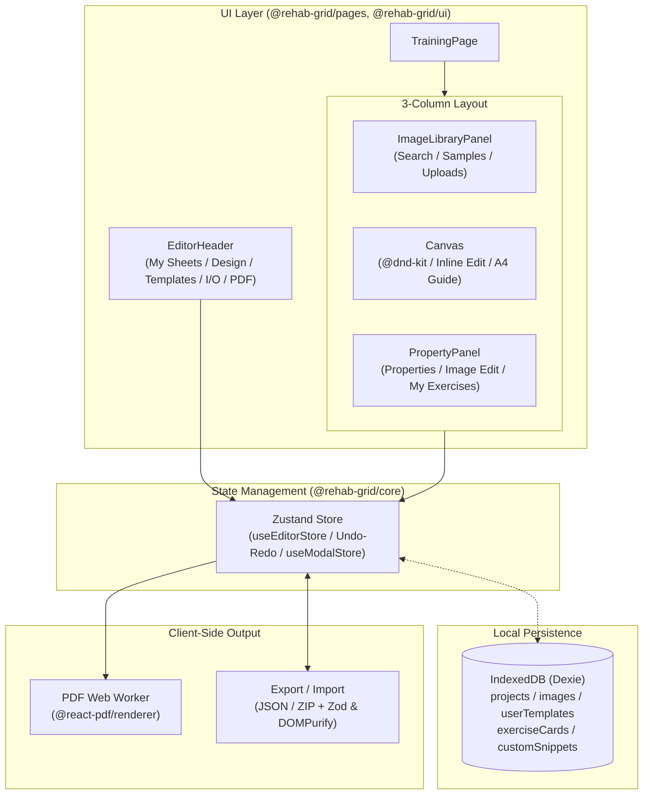

<div align="center">


# Rehab-Grid

**A local-first Home Exercise Program (HEP) sheet builder for rehabilitation therapists.**

[日本語](./README.md) | **English**

[Launch Web App](https://rehaguri.com) · [Download for Windows](https://github.com/Sierra117-KF/rehab-grid/releases/latest) · [Changelog](./CHANGELOG.md) · [Report Issue](https://github.com/Sierra117-KF/rehab-grid/issues)

[](https://github.com/Sierra117-KF/rehab-grid/releases/latest)
[](https://github.com/Sierra117-KF/rehab-grid/actions/workflows/ci.yml)
[](https://www.gnu.org/licenses/agpl-3.0)
[](https://nextjs.org/)
[](https://react.dev/)
[](https://www.typescriptlang.org/)
[](https://v2.tauri.app/)

<br />


</div>

---

## Table of Contents

- [Overview](#overview)
- [Key Features](#key-features)
- [Security, Privacy & Regulatory Positioning](#security-privacy--regulatory-positioning)
- [Disclaimer](#disclaimer)
- [Tech Stack & Architecture](#tech-stack--architecture)
- [Getting Started](#getting-started)
- [Project Structure & Commands](#project-structure--commands)
- [Contributing](#contributing)
- [Related Documentation](#related-documentation)
- [License](#license)

---

## Overview

**Rehab-Grid** ("リハぐり" in Japanese) is a tool designed for rehabilitation professionals — Physical Therapists (PT), Occupational Therapists (OT), and Speech-Language-Hearing Therapists (ST) — to quickly create clear, printable self-training / Home Exercise Program (HEP) handouts.

Built as a **100% client-side, local-first application**, Rehab-Grid processes and stores everything directly on the user's device with **zero external data transmission**. This enables hospitals and clinics to adopt it without conflicting with strict institutional data security policies.

### Platforms

| Platform | How to Use | Highlights |
| -------- | ---------- | ---------- |
| **Web App** | Open [rehaguri.com](https://rehaguri.com) | No account required · PWA-enabled with offline PDF generation |
| **Desktop App** | Download installer from [Releases](https://github.com/Sierra117-KF/rehab-grid/releases/latest) (Windows 10/11 64-bit / Tauri 2) | Standalone native app · Fully offline operation |

### Why Rehab-Grid over Word / PowerPoint?

| Pain Point | Word / PowerPoint | Rehab-Grid |
| ---------- | ----------------- | ---------- |
| Layout alignment | Manually resizing images, borders, and text boxes | Automatic 1–4 column grid or slide layout as you add cards |
| Reusing frequent exercises | Digging through old files to copy and paste | Built-in My Sheets, My Templates, My Exercises, and My Snippets |
| Print & accessibility tweaks | Reformatting every document for monochrome or older adults | One-click presets (Standard Color, Monochrome / Ink-Saver, Large Text for Seniors) |
| Data security | Cloud sync or external upload concerns | Strictly local-only execution enforced by a restrictive CSP |

---

## Key Features

### Card-Based Editor & Layout

- **Structured Exercise Cards**: Manage up to 10 cards per sheet and reorder effortlessly via drag and drop
- **Responsive Grid, Slide Layout & Auto-Fit Typography**: Switch between 1–4 columns or Slide layout (one large exercise per landscape A4 page); long dosage labels/values automatically scale down to stay cleanly on a single line in both the editor and PDF
- **Fast Editing Workflow**: Double-click inline editing on desktop cards, one-click card duplication, and "Apply to All Cards" for dosages and precautions
- **Undo / Redo History**: Up to 50 history steps with keyboard shortcuts (`Ctrl+Z` / `Ctrl+Shift+Z` / `Ctrl+Y`)

### Image Library & Client-Side Image Editor

- **Built-In Exercise Library**: 42 two-panel sample exercise illustrations (10 standing, 12 sitting, 20 lying) with lightweight thumbnails for fast browsing and forgiving keyword search (ignoring kana/width variations)
- **Flexible Image Import**: Local file upload, drag and drop (JPEG / PNG / GIF / WebP, up to 20 MB), or direct clipboard paste (`Ctrl+V` / `Cmd+V`), with automatic client-side compression
- **Image Editor Modal**: Full or per-panel horizontal flip, 90° rotation, 5:3 cropping, and arrow/circle/rectangle annotations (saves as a new image while keeping the original intact)

### Print Styling & PDF Generation

- **Customizable Print Design**:
  - Theme colors (6 print-friendly presets + custom color picker / hex input)
  - Page orientation (Auto / Portrait / Landscape), print color mode (Color / Monochrome Ink-Saver), text scale (Standard / Large), optional card numbers, and customizable dosage labels
  - Quick presets for Standard Color, Monochrome / Ink-Saver, and Senior-Friendly layouts
- **Sheet Header & Adherence Checklists**: Optional date field (blank line or print date), handwritten patient name box (no patient name input stored), weekly or monthly adherence check tables, and automatic multi-page numbering
- **A4 Page Fit Guide**: Real-time estimated page count and page-break indicators directly inside the editor
- **Non-Blocking Client-Side PDF**: Embedded local Japanese fonts (Noto Sans JP) rendered inside a Web Worker; precached by the Service Worker so PDF export works even offline

### Personal Libraries, Storage & Backup

- **My Sheets (Multi-Project Library)**: Save and manage multiple instruction sheets locally in IndexedDB with search, switching, duplication, deletion, and 2-second debounced auto-save
- **My Templates, My Exercises & My Snippets**: Alongside 8 official preset templates and built-in precaution snippets, save your own templates, individual exercise cards, and custom precaution phrases
- **Portable Backups**: Export lightweight text-only `.json` or full `.zip` backups (including images). All imports are validated and sanitized with Zod + DOMPurify, with a choice to open as a new sheet or overwrite the current one

---

## Security, Privacy & Regulatory Positioning

> [!IMPORTANT]
> Rehab-Grid runs **100% locally on your device**. No user inputs, images, or generated PDFs are ever transmitted to external servers. No analytics (such as Google Analytics) or cookies are used.

### Data Storage & Technical Safeguards

- **Local Persistence**: Data is stored in your browser's **IndexedDB**. It persists across restarts, though clearing browser cache or closing private/incognito sessions will erase it
- **Strict Content Security Policy (CSP)**: Technically blocks outbound requests and third-party scripts/fonts
- **Recommended Environment**: For shared clinical workstations, use an up-to-date browser (and consider Guest or Incognito mode where extensions are disabled by default)

<details>
<summary>View Content Security Policy (CSP) details</summary>

```text
default-src 'self';
img-src 'self' blob: data:;
style-src 'self' 'unsafe-inline';
script-src 'self' 'unsafe-inline' 'wasm-unsafe-eval';
font-src 'self';
connect-src 'self';
worker-src 'self' blob:;
frame-src 'self' blob:;
object-src 'none';
base-uri 'self';
frame-ancestors 'none';
form-action 'self';
```

- **Where it is enforced**:
  - `apps/web/public/_headers`: Production HTTP headers (e.g., Cloudflare Pages)
  - `apps/web/src/app/layout.tsx`: `<meta>` fallback (`frame-ancestors` applies via `_headers` only)
  - **Desktop additional CSP**: `connect-src 'self' ipc: http://ipc.localhost tauri:;`
- **Key directives**:
  - `script-src 'self' 'unsafe-inline' 'wasm-unsafe-eval'`: Required for Next.js static export hydration (server-side nonces are unavailable) and WebAssembly used by `fontkit` inside PDF generation (`'unsafe-eval'` is added only in local dev for HMR)
  - `worker-src 'self' blob:` / `frame-src 'self' blob:`: Required for the PDF Web Worker and displaying generated PDF Object URLs in the preview iframe
  - `object-src 'none'` / `base-uri 'self'`: Disables legacy plugins and prevents base URL injection

</details>

### Regulatory Positioning

Rehab-Grid is a local document-authoring tool (editor), not a cloud service (SaaS) that collects, stores, or manages user data on remote servers. Accordingly, in Japan it does not fall under "target providers" as defined by the METI/MIC *Guidelines for Safety Management by Providers of Information Systems and Services Handling Medical Information*.

When used in healthcare settings, responsibility for managing created data and printed/PDF outputs rests entirely with the user and their affiliated institution. Please follow your organization's internal security policies, just as you would with Microsoft Word or Excel.

---

## Disclaimer

> [!WARNING]
> **Prohibited Use**: Do not upload identifiable photos of real patients/clients (faces, name tags, distinctive personal features) and do not enter patient names, detailed medical histories, or other sensitive personal information into free-text fields.

- **Data Loss**: Data in IndexedDB may be lost due to cache clearing, ending private browsing, browser reinstalls, or device resets. **Always export important sheets as `.json` or `.zip` backups.**
- **Security Boundaries**: While local-only operation and strict CSP are implemented, security cannot be guaranteed against compromised user environments (malicious browser extensions, malware, OS/browser vulnerabilities). On shared PCs, close the browser and clear cache after use when appropriate.
- **Medical Accuracy**: Medical appropriateness and accuracy of created exercise sheets are not guaranteed; clinical judgment remains solely with the licensed therapist.
- **Changes & Availability**: The provider may modify or discontinue the service without prior notice and assumes no liability for resulting damages except in cases of intentional misconduct or gross negligence.

---

## Tech Stack & Architecture

| Category | Technologies |
| -------- | ------------ |
| Framework & UI | Next.js 16 (App Router, Static Export), React 19, TypeScript 5, Tailwind CSS 4 |
| Desktop & Monorepo | Tauri 2 (Windows / Rust), Turborepo 2, pnpm 11 |
| State, Storage & Validation | Zustand 5, Dexie 4 (IndexedDB), Zod 4, DOMPurify |
| Components & Interaction | shadcn/ui + Radix UI, Lucide React, @dnd-kit, Sonner |
| PDF, Images & Archives | @react-pdf/renderer 4 (Web Worker), browser-image-compression, JSZip |
| Testing & Quality | Vitest 4, Testing Library (jsdom), Vitest Browser (Playwright), ESLint 9 (`strictTypeChecked`) |

### Architecture Overview



---

## Getting Started

### Prerequisites

- **Node.js**: 22.x or higher (CI runs on Node.js 22)
- **pnpm**: 11.x or higher (`packageManager: pnpm@11.13.1`)
- **Desktop builds only**: Rust (1.90+), Windows WebView2 Runtime

### Quick Start

```bash
# 1. Clone the repository
git clone https://github.com/Sierra117-KF/rehab-grid.git
cd rehab-grid

# 2. Install dependencies
pnpm install

# 3. Start the development server
pnpm dev:web      # Web app (http://localhost:3000)
pnpm dev:desktop  # Desktop app (Tauri)
```

---

## Project Structure & Commands

Rehab-Grid uses a **Turborepo + pnpm workspace** monorepo:

```text
rehab-grid/
├── apps/
│   ├── desktop/      # Windows desktop app (Tauri 2 + Next.js)
│   └── web/          # Web app (PWA / static export for Cloudflare Pages)
├── packages/
│   ├── assets/       # Shared static assets (fonts, icons, sample images, templates)
│   ├── config/       # Shared ESLint, TypeScript, and PostCSS configs
│   ├── core/         # Core logic (DB, Store, PDF builder, Schemas, Hooks, Utils)
│   ├── pages/        # Shared page components (training, privacy, terms, changelog)
│   └── ui/           # Shared UI components (editor, layout, ui, wrapped)
├── docs/             # Architecture, testing, and release documentation
└── scripts/          # Font subsetting, thumbnail, OGP, and PWA icon scripts
```

Package dependency graph: `apps/{web,desktop}` → `@rehab-grid/pages` → `@rehab-grid/ui` → `@rehab-grid/core`

> [!NOTE]
> Shared assets in `packages/assets/` are automatically copied into each app's `public/` directory during dev/build (excluded from Git). Do not edit files in `packages/ui/src/components/ui/` directly — wrap shadcn/ui primitives in `packages/ui/src/components/wrapped/` instead.

### Common Commands

```bash
# Development
pnpm dev                # All apps
pnpm dev:web            # Web app only
pnpm dev:desktop        # Desktop app (Tauri)

# Production builds
pnpm build              # Build all workspaces
pnpm build:web          # Static web export to apps/web/out/
pnpm build:desktop      # Windows NSIS installer

# Quality checks
pnpm lint               # Lint all packages (auto-fix: pnpm lint:fix)
pnpm type-check         # Type-check source files
pnpm type-check:test    # Type-check test files

# Tests
pnpm test               # Run all tests once
pnpm test:jsdom         # jsdom tests only (core / ui / desktop)
pnpm test:browser       # Browser tests only (web / Playwright)
pnpm test:watch         # Watch mode
pnpm test:coverage      # Coverage report

# Target a single package
pnpm --filter @rehab-grid/core test
```

<details>
<summary>For Developers: Adding an Official Preset Template</summary>

1. Create an exercise sheet in `/training` and export it as ZIP (or JSON) from the header Export menu
2. Create `packages/assets/templates/{template-id}/` and place `project.json` (plus `images/` if custom images are needed; alphanumeric and hyphens only, referencing built-in sample image IDs where possible)
3. Register the template metadata in the `TEMPLATES` array in `packages/core/src/lib/templates/index.ts`
4. Run `pnpm dev:web` and verify the template in the template selection modal

See [packages/assets/README.md](./packages/assets/README.md) for schema details and sample image guidelines.

</details>

---

## Contributing

Contributions, bug reports, and feature requests are welcome! See [.github/CONTRIBUTING.md](./.github/CONTRIBUTING.md) for full details.

- **Issues**: Please use the provided [GitHub Issue templates](https://github.com/Sierra117-KF/rehab-grid/issues) (Bug Report / Feature Request)
- **Pull Requests**:
  1. Fork the repository and create a branch (`git checkout -b feature/your-feature`)
  2. Verify all checks pass before committing:
     ```bash
     pnpm lint && pnpm type-check && pnpm type-check:test && pnpm test
     ```
  3. Do not introduce external network requests, disable ESLint rules, or edit `packages/ui/src/components/ui/` directly
  4. Open a Pull Request and complete the PR template checklist

---

## Related Documentation

| Document | Description |
| -------- | ----------- |
| [CHANGELOG.md](./CHANGELOG.md) | Version-by-version release history |
| [docs/architecture.md](./docs/architecture.md) | Architecture, specifications, CSP, and monorepo guidelines |
| [docs/testing-guide.md](./docs/testing-guide.md) | Testing setup, commands, and conventions |
| [docs/release-guide.md](./docs/release-guide.md) | Release process and GitHub Releases workflow |
| [apps/README.md](./apps/README.md) | Apps overview ([web](./apps/web/README.md) / [desktop](./apps/desktop/README.md)) |
| [packages/README.md](./packages/README.md) | Internal packages overview ([assets](./packages/assets/README.md) / [config](./packages/config/README.md) / [core](./packages/core/README.md) / [pages](./packages/pages/README.md) / [ui](./packages/ui/README.md)) |
| [scripts/README.md](./scripts/README.md) | Build & asset generation scripts |
| [.github/CONTRIBUTING.md](./.github/CONTRIBUTING.md) | Contribution and CI/CD guide |

---

## License

This project is licensed under the [GNU Affero General Public License v3.0 (AGPL-3.0)](https://www.gnu.org/licenses/agpl-3.0).

- **Permitted**: Free to use, copy, modify, and redistribute for both commercial and non-commercial purposes, including clinical, care, welfare, and educational use
- **Obligations**: Modified versions and network-hosted deployments must make their source code available under AGPL-3.0 and retain original copyright and license notices
- **Trademark / Name**: The "Rehab-Grid" ("リハぐり") name and logo are owned separately from the source license. If you publish a modified service, please use a different name and logo to avoid confusion

<details>
<summary>License notice templates for forks & modifications</summary>

#### For README

```text
## License

This project is based on [Rehab-Grid](https://github.com/Sierra117-KF/rehab-grid) by Sierra117-KF.

Original work Copyright (C) 2026 Sierra117-KF
Modified by [Your Name/Organization] ([Modification Date: YYYY-MM-DD])

This program is free software: you can redistribute it and/or modify
it under the terms of the GNU Affero General Public License as published
by the Free Software Foundation, either version 3 of the License, or
(at your option) any later version.

Source code: [Your Repository URL]
```

#### For Source Files (Header Comment)

```text
/**
 * This file is part of [Your Project Name], based on Rehab-Grid.
 *
 * Original work Copyright (C) 2026 Sierra117-KF
 * Modified by [Your Name] on [YYYY-MM-DD]
 *
 * This program is free software: you can redistribute it and/or modify
 * it under the terms of the GNU Affero General Public License as published
 * by the Free Software Foundation, either version 3 of the License, or
 * (at your option) any later version.
 *
 * Source: https://github.com/[your-username]/[your-repo]
 */
```

</details>
