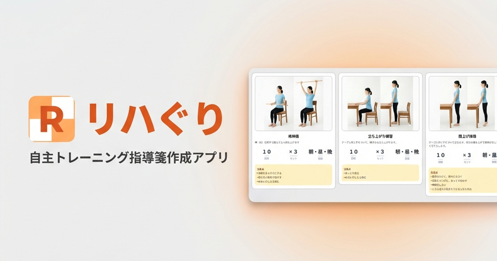
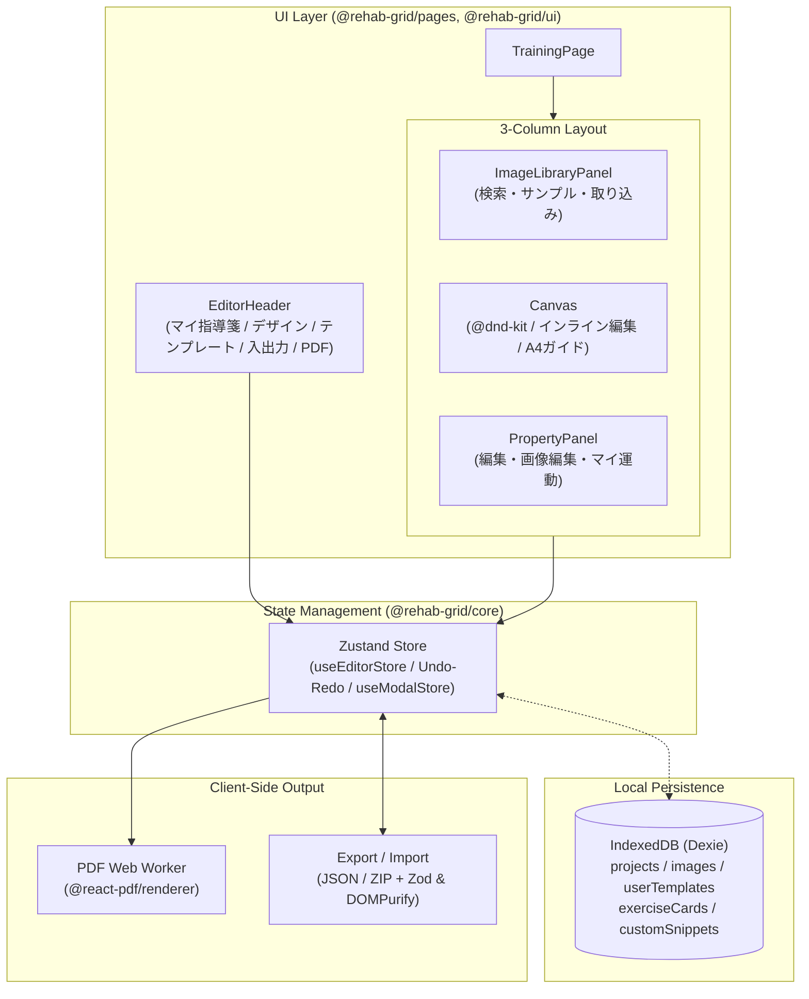

<div align="center">


# リハぐり（Rehab-Grid）

**リハビリテーションセラピストのための、完全ローカル動作・自主トレーニング指導箋作成ツール**

**日本語** | [English](./README.en.md)

[Web版を使う](https://rehaguri.com) · [Windows版ダウンロード](https://github.com/Sierra117-KF/rehab-grid/releases/latest) · [変更履歴](./CHANGELOG.md) · [バグ報告・要望](https://github.com/Sierra117-KF/rehab-grid/issues)

[](https://github.com/Sierra117-KF/rehab-grid/releases/latest)
[](https://github.com/Sierra117-KF/rehab-grid/actions/workflows/ci.yml)
[](https://www.gnu.org/licenses/agpl-3.0)
[](https://nextjs.org/)
[](https://react.dev/)
[](https://www.typescriptlang.org/)
[](https://v2.tauri.app/)

<br />



</div>

---

## 目次

- [概要](#概要)
- [主な機能](#主な機能)
- [セキュリティ・プライバシーとガイドライン上の位置づけ](#セキュリティプライバシーとガイドライン上の位置づけ)
- [免責事項](#免責事項)
- [技術スタック・アーキテクチャ](#技術スタックアーキテクチャ)
- [開発環境のセットアップ](#開発環境のセットアップ)
- [プロジェクト構成・コマンド](#プロジェクト構成コマンド)
- [貢献（Contributing）](#貢献contributing)
- [関連ドキュメント](#関連ドキュメント)
- [ライセンス](#ライセンス)

---

## 概要

**リハぐり（Rehab-Grid）** は、理学療法士（PT）・作業療法士（OT）・言語聴覚士（ST）などのリハビリテーション専門職向けに開発された、自主トレーニング指導箋の作成支援ツールです。

すべてのデータ処理を端末内（ブラウザ／デスクトップアプリ）で完結させ、**外部サーバーへのデータ送信を一切行わない設計**により、医療機関・介護施設のセキュリティ規定に抵触せず安心して導入できます。

### プラットフォーム

| プラットフォーム | 利用方法 | 主な特徴 |
| ---------------- | -------- | -------- |
| **Web版** | [rehaguri.com](https://rehaguri.com) にアクセス | 登録不要で即利用可能・PWA対応でオフラインでもPDF生成まで動作 |
| **Desktop版** | [Releases](https://github.com/Sierra117-KF/rehab-grid/releases/latest) からインストーラーを入手（Windows 10/11 64bit / Tauri 2） | ブラウザ不要のネイティブ起動・完全オフライン動作 |

### Word / PowerPoint との違い

| 現場の課題 | Word / PowerPoint | リハぐり |
| ---------- | ----------------- | -------- |
| レイアウト調整 | 画像やテキストの位置・枠線を手動で微調整 | カードを追加するだけで 1〜4 列の自動グリッド配置 |
| よく使う指導内容の再利用 | 過去ファイルを探してコピー＆ペースト | マイ指導箋・マイテンプレート・マイ運動・マイ定型文で一元管理 |
| 印刷・高齢者配慮の調整 | 文字サイズや白黒見やすさを毎回作り直し | 用途別プリセット（標準カラー／白黒・インク節約／高齢者向け）で切替 |
| データセキュリティ | クラウド保存時に院外送信の懸念 | 完全ローカル動作・外部通信ゼロ（CSP で技術的に遮断） |

---

## 主な機能

### カード編集・レイアウト

- **カード型エディタ**: 最大 10 枚の運動カードをドラッグ＆ドロップで直感的に並び替え
- **自動グリッドレイアウト**: 1〜4 列のレイアウト切替と、長めの用量テキストを 1 行に自動縮小して揃える表示調整（編集画面・PDF 両対応）
- **快適な編集操作**: デスクトップでのカード上ダブルクリックによるインライン編集、カードの複製、回数・セット・頻度や注意点の「全カードに反映」
- **編集履歴（Undo / Redo）**: 最大 50 件の履歴管理とショートカット（`Ctrl+Z` / `Ctrl+Shift+Z` / `Ctrl+Y`）

### 画像ライブラリ・クライアントサイド画像編集

- **サンプル画像ライブラリ**: 立位（10 枚）・座位（12 枚）・臥位（20 枚）の計 42 枚の 2 コマ運動画像を標準収録。一覧表示は軽量サムネイルで高速読み込みし、ひらがな・カタカナ・全角半角の表記揺れを吸収するキーワード検索に対応
- **多様な画像取り込み**: ローカルファイル選択・ドラッグ＆ドロップ（JPEG / PNG / GIF / WebP、最大 20MB）およびクリップボード貼り付け（`Ctrl+V` / `Cmd+V`）。取り込み時に自動圧縮して保存
- **画像編集機能**:
  - **クイック左右反転**: 2 コマ構成のサンプル画像はコマの順序を保ったまま 2 コマずつ反転
  - **画像編集モーダル**: 全体／2 コマずつの左右反転、90° 回転、横 5:縦 3 トリミング、矢印・丸・四角の注釈描画（編集結果は別画像として保存し、元画像を保持）

### デザイン設定・PDF 出力

- **印刷スタイルと用途別プリセット**:
  - テーマカラー（プリセット 6 色＋カラーピッカー／カラーコード入力）
  - 用紙の向き（自動／縦／横）、印刷の色（カラー／白黒・インク節約）、文字サイズ（標準／大きめ）、カード番号バッジ、用量ラベルのカスタマイズ
  - 「標準カラー」「白黒・インク節約」「高齢者向け」の用途別プリセット
- **PDF ヘッダー・実施チェック表**: 病院・施設名、担当者名、日付欄（記入欄／出力日印字）、氏名の手書き枠、全体メモの設定に加え、自主トレ実施チェック表（1 週間／1 か月）や複数ページ時のページ番号出力に対応
- **A4 ページ収容ガイド**: 編集画面上で PDF のページ数目安と改ページ位置をリアルタイム表示
- **クライアントサイド PDF 生成**: 日本語フォント（Noto Sans JP）をローカル埋め込み。Web Worker による非同期生成でメインスレッドをブロックせず、PWA ではオフライン時も生成可能

### マイライブラリ・保存とバックアップ

- **マイ指導箋（複数指導箋管理）**: 複数の指導箋を IndexedDB に保存し、タイトル検索・切り替え・新規作成・複製・削除が可能（最後の変更から 2 秒でオートセーブ）
- **マイテンプレート／マイ運動／マイ定型文**: 8 種類の公式プリセットテンプレートに加え、自分専用のテンプレート・運動カード・注意点定型文を保存して繰り返し活用可能
- **バックアップと復元**: テキストのみの軽量 JSON 形式と、画像を含む完全バックアップ ZIP 形式のエクスポート／インポートに対応。インポート時は Zod + DOMPurify による厳格な検証・サニタイズを行い、「新しい指導箋で開く」または「現在の指導箋に上書き」を選択可能

---

## セキュリティ・プライバシーとガイドライン上の位置づけ

> [!IMPORTANT]
> 本アプリは **完全ローカル動作** です。入力内容・画像・PDF が外部サーバーへ送信されることは一切ありません。Google Analytics などのアクセス解析や Cookie も使用していません。

### データの保存と保護

- **保存先**: 端末内のブラウザストレージ（IndexedDB）。ブラウザ終了後も保持されますが、キャッシュ削除やシークレットモード終了で消去されます
- **外部通信の技術的遮断**: 厳格な Content Security Policy（CSP）により、意図しない外部通信・CDN 読み込みを禁止しています
- **推奨利用環境**: 共有 PC 等でより安全に利用するため、最新バージョンのブラウザ（必要に応じてゲストモード／シークレットモード）の利用を推奨します

<details>
<summary>Content Security Policy（CSP）の詳細設定を見る</summary>

```text
default-src 'self';
img-src 'self' blob: data:;
style-src 'self' 'unsafe-inline';
script-src 'self' 'unsafe-inline' 'wasm-unsafe-eval';
font-src 'self';
connect-src 'self';
worker-src 'self' blob:;
frame-src 'self' blob:;
object-src 'none';
base-uri 'self';
frame-ancestors 'none';
form-action 'self';
```

- **実装場所**:
  - `apps/web/public/_headers`: 本番ホスティング（Cloudflare Pages 等）向け HTTP ヘッダー
  - `apps/web/src/app/layout.tsx`: `<meta>` タグによるフォールバック（`frame-ancestors` は `_headers` のみ）
  - **Desktop 版追加 CSP**: `connect-src 'self' ipc: http://ipc.localhost tauri:;`
- **主なディレクティブの理由**:
  - `script-src 'self' 'unsafe-inline' 'wasm-unsafe-eval'`: Next.js の静的エクスポート（`output: 'export'`）のハイドレーションおよび PDF 生成ライブラリ（fontkit）の WebAssembly 実行に必要（開発環境では HMR のため `'unsafe-eval'` を自動付与）
  - `worker-src 'self' blob:` / `frame-src 'self' blob:`: PDF 生成 Web Worker および PDF プレビュー用 `blob:` Object URL 表示に必要
  - `object-src 'none'` / `base-uri 'self'`: プラグイン無効化およびベース URL 制限によるインジェクション防止

</details>

### ガイドライン上の位置づけ

本アプリはブラウザ／端末上で動作する「資料作成ツール（エディタ）」であり、開発者がユーザーの入力データを預かり管理するクラウドサービス（SaaS）ではありません。したがって、経済産業省・総務省「医療情報を取り扱う情報システム・サービスの提供事業者における安全管理ガイドライン」における対象事業者には該当しません。

医療機関等での業務利用において、作成されたデータおよび出力物（PDF・紙媒体）の管理責任は利用者および所属機関に帰属します。Microsoft Word や Excel 等を業務利用する場合と同様に、各施設のセキュリティポリシーに沿ってご利用ください。

---

## 免責事項

> [!WARNING]
> **禁止事項**: 実際の患者・利用者の顔写真や個人が容易に特定できる画像（名札・特徴的な身体的特徴等）のアップロード、および自由入力欄への患者氏名・詳細な病歴その他要配慮個人情報の入力は禁止されています。

- **データの保存と消失**: ブラウザの履歴・キャッシュ削除、シークレットモード終了、ブラウザ更新・再インストール、端末初期化等によりデータが消失する可能性があります。**重要な指導箋は必ず JSON / ZIP ファイルとしてバックアップしてください。**
- **セキュリティの限界**: 端末のマルウェア感染、悪意のあるブラウザ拡張機能、OS・ブラウザの脆弱性等によるリスクを完全に排除することはできません。共有 PC では作業後にブラウザを閉じ、必要に応じてキャッシュを削除してください。
- **医学的正確性**: 本アプリで作成された指導箋の医学的正確性は保証しません。内容の適切性は使用するリハビリテーション専門職自身が判断してください。
- **サービスの変更・終了**: 提供者は事前通知なく本サービスの内容を変更・終了することがあります。提供者の故意または重大な過失がある場合を除き、利用により生じた損害について責任を負いません。

---

## 技術スタック・アーキテクチャ

| カテゴリ | 採用技術 |
| -------- | -------- |
| フレームワーク / UI | Next.js 16（App Router / 静的エクスポート）、React 19、TypeScript 5、Tailwind CSS 4 |
| デスクトップ / モノレポ | Tauri 2（Windows / Rust）、Turborepo 2、pnpm 11 |
| 状態管理・データ・検証 | Zustand 5、Dexie 4（IndexedDB）、Zod 4、DOMPurify |
| UI コンポーネント・操作 | shadcn/ui + Radix UI、Lucide React、@dnd-kit、Sonner |
| PDF・画像・ZIP 処理 | @react-pdf/renderer 4（Web Worker）、browser-image-compression、JSZip |
| テスト・品質管理 | Vitest 4、Testing Library（jsdom）、Vitest Browser（Playwright）、ESLint 9（strictTypeChecked） |

### アーキテクチャ概要



---

## 開発環境のセットアップ

### 必要な環境

- **Node.js**: 22.x 以上（CI 検証環境: Node.js 22）
- **pnpm**: 11.x 以上（`packageManager: pnpm@11.13.1`）
- **Desktop 版開発時のみ**: Rust（1.90 以上）、Windows WebView2 Runtime

### クイックスタート

```bash
# 1. リポジトリをクローン
git clone https://github.com/Sierra117-KF/rehab-grid.git
cd rehab-grid

# 2. 依存関係をインストール
pnpm install

# 3. 開発サーバーを起動
pnpm dev:web      # Web版（http://localhost:3000）
pnpm dev:desktop  # Desktop版（Tauri）
```

---

## プロジェクト構成・コマンド

本リポジトリは **Turborepo + pnpm workspace** によるモノレポ構成です。

```text
rehab-grid/
├── apps/
│   ├── desktop/      # Windows版ネイティブアプリ（Tauri 2 + Next.js）
│   └── web/          # Web版（PWA / Cloudflare Pages 向け静的エクスポート）
├── packages/
│   ├── assets/       # 共有アセット（フォント・アイコン・サンプル画像・テンプレート）
│   ├── config/       # 共有設定（ESLint / TypeScript / PostCSS）
│   ├── core/         # コアロジック（DB / Store / PDF生成 / Schemas / Hooks / Utils）
│   ├── pages/        # 共有ページコンポーネント（training / privacy / terms / changelog）
│   └── ui/           # 共有UIコンポーネント（editor / layout / ui / wrapped）
├── docs/             # アーキテクチャ・テスト・リリース手順書
└── scripts/          # フォントサブセット・サムネイル・OGP・PWAアイコン生成スクリプト
```

パッケージ依存関係: `apps/{web,desktop}` → `@rehab-grid/pages` → `@rehab-grid/ui` → `@rehab-grid/core`

> [!NOTE]
> `packages/assets/` に配置した共有アセットはビルド／開発起動時に各アプリの `public/` へ自動コピーされます（コピー先は Git 管理外）。また `packages/ui/src/components/ui/` は shadcn/ui の原本のため直接編集せず、`wrapped/` にラッパーを作成してください。

### 主な開発コマンド

```bash
# 開発サーバー
pnpm dev                # 全アプリ
pnpm dev:web            # Web版のみ
pnpm dev:desktop        # Desktop版（Tauri）

# ビルド
pnpm build              # 全体ビルド
pnpm build:web          # Web版（apps/web/out/ に静的出力）
pnpm build:desktop      # Desktop版（NSIS インストーラー生成）

# 品質チェック
pnpm lint               # 全パッケージのリント（自動修正: pnpm lint:fix）
pnpm type-check         # ソースコードの型チェック
pnpm type-check:test    # テストコードの型チェック

# テスト
pnpm test               # 全テスト（単発実行）
pnpm test:jsdom         # jsdom 環境のみ（core / ui / desktop）
pnpm test:browser       # ブラウザ環境のみ（web / Playwright）
pnpm test:watch         # ウォッチモード
pnpm test:coverage      # カバレッジ計測

# パッケージ指定の例
pnpm --filter @rehab-grid/core test
```

<details>
<summary>開発者向け: 公式プリセットテンプレートの追加手順</summary>

1. `/training` エディタで運動メニューを作成し、ヘッダーの「バックアップ」から ZIP（または JSON）をエクスポート
2. `packages/assets/templates/{template-id}/` を作成し、`project.json`（独自画像を使う場合は `images/` も）を配置（ディレクトリ名は英数字とハイフンのみ。サンプル画像は ID 参照を推奨）
3. `packages/core/src/lib/templates/index.ts` の `TEMPLATES` 配列にメタデータを追加
4. `pnpm dev:web` を起動し、テンプレート選択モーダルで表示・読み込みを確認

詳細なスキーマやサンプル画像追加手順は [packages/assets/README.md](./packages/assets/README.md) を参照してください。

</details>

---

## 貢献（Contributing）

バグ報告・機能要望・Pull Request を歓迎します。詳細は [.github/CONTRIBUTING.md](./.github/CONTRIBUTING.md) をご覧ください。

- **Issue**: [GitHub Issues](https://github.com/Sierra117-KF/rehab-grid/issues) のテンプレート（バグ報告／機能要望）をご利用ください
- **Pull Request**:
  1. リポジトリをフォークし、ブランチを作成（`git checkout -b feature/your-feature`）
  2. 変更を実装し、コミット前に以下がすべて通ることを確認:
     ```bash
     pnpm lint && pnpm type-check && pnpm type-check:test && pnpm test
     ```
  3. 外部通信の追加・ESLint ルールの無効化・`packages/ui/src/components/ui/` の直接編集は行わないでください
  4. PR を作成し、自動適用されるテンプレートに沿って記入してください

---

## 関連ドキュメント

| ドキュメント | 内容 |
| ------------ | ---- |
| [CHANGELOG.md](./CHANGELOG.md) | バージョン別の変更履歴 |
| [docs/architecture.md](./docs/architecture.md) | アーキテクチャ・機能仕様・CSP・モノレポ設計リファレンス |
| [docs/testing-guide.md](./docs/testing-guide.md) | テスト環境・実行方法・ガイドライン |
| [docs/release-guide.md](./docs/release-guide.md) | リリース手順・GitHub Releases 運用ガイド |
| [apps/README.md](./apps/README.md) | Web版・Desktop版アプリケーション概要（[web](./apps/web/README.md) / [desktop](./apps/desktop/README.md)） |
| [packages/README.md](./packages/README.md) | 内部パッケージ全体ガイド（[assets](./packages/assets/README.md) / [config](./packages/config/README.md) / [core](./packages/core/README.md) / [pages](./packages/pages/README.md) / [ui](./packages/ui/README.md)） |
| [scripts/README.md](./scripts/README.md) | フォント・画像・アイコン生成スクリプトのガイド |
| [.github/CONTRIBUTING.md](./.github/CONTRIBUTING.md) | コントリビューション・CI/CD 運用ガイド |

---

## ライセンス

このプロジェクトは [GNU Affero General Public License v3.0 (AGPL-3.0)](https://www.gnu.org/licenses/agpl-3.0) の下で公開されています。

- **許可されること**: 商用・非商用および医療・介護・福祉・教育機関での業務利用を含む自由な使用・複製・改変・再配布
- **義務**: 改変物の公開・ネットワーク経由でのサービス提供時には、同じ AGPL-3.0 の下でソースコードへのアクセス手段を提供し、著作権表示とライセンス表示を保持する必要があります
- **「リハぐり」の名称・ロゴについて**: ソースコードのライセンスとは別に提供者が権利を保有しています。改変版を公開する場合は混同を避けるため別の名称・ロゴを使用してください

<details>
<summary>フォーク・改変時のライセンス表示テンプレートを見る</summary>

#### README 用テンプレート

```text
## License

This project is based on [Rehab-Grid](https://github.com/Sierra117-KF/rehab-grid) by Sierra117-KF.

Original work Copyright (C) 2026 Sierra117-KF
Modified by [あなたの名前/組織名] ([改変日: YYYY-MM-DD])

This program is free software: you can redistribute it and/or modify
it under the terms of the GNU Affero General Public License as published
by the Free Software Foundation, either version 3 of the License, or
(at your option) any later version.

Source code: [あなたのリポジトリURL]
```

#### ソースファイル用テンプレート（ファイルヘッダー）

```text
/**
 * This file is part of [Your Project Name], based on Rehab-Grid.
 *
 * Original work Copyright (C) 2026 Sierra117-KF
 * Modified by [Your Name] on [YYYY-MM-DD]
 *
 * This program is free software: you can redistribute it and/or modify
 * it under the terms of the GNU Affero General Public License as published
 * by the Free Software Foundation, either version 3 of the License, or
 * (at your option) any later version.
 *
 * Source: https://github.com/[your-username]/[your-repo]
 */
```

</details>
